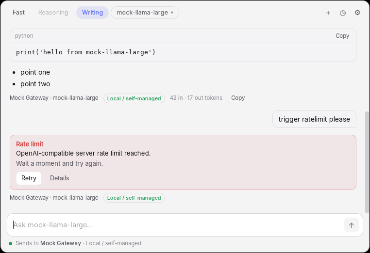
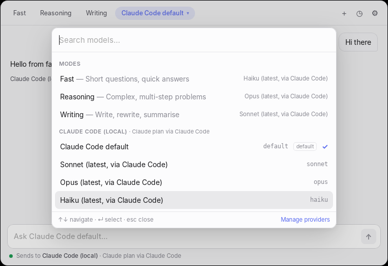
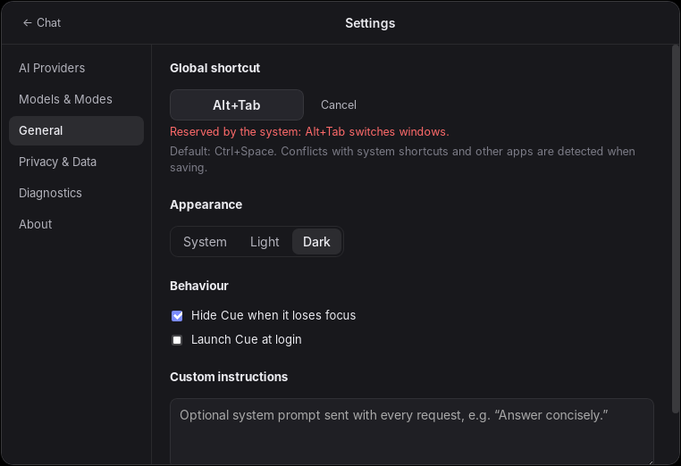

# Cue

**Ein schneller, unaufdringlicher KI-Assistent für macOS und Windows.**
Eine Tastenkombination – und Anthropic Claude, OpenAI/ChatGPT, Google Gemini
oder ein lokales Modell antworten in einem kleinen schwebenden Fenster, ohne
dass du deinen Workflow verlässt.



| Modell-Picker (`Ctrl/⌘ K`) | Einstellungen, Dark Mode |
|---|---|
|  |  |

## Funktionen

- **Globale Tastenkombination** – Standard `Option+Space` (macOS) /
  `Ctrl+Space` (Windows), frei konfigurierbar mit Konflikterkennung.
- **Schwebende Palette** auf dem Monitor unter dem Mauszeiger, sofortiger
  Fokus, `Esc` schließt, Klick daneben blendet aus.
- **Mehrere Anbieter, eine Oberfläche:** Anthropic (API-Schlüssel),
  Claude Code (deine lokale Installation, z. B. mit Claude Pro/Max),
  ChatGPT-Plan (offizielles „Sign in with ChatGPT“), OpenAI-API, Google Gemini,
  OpenAI-kompatible Dienste (OpenRouter, Groq, Mistral …) und lokale Server
  (Ollama, LM Studio).
- **Modi:** *Fast*, *Reasoning*, *Writing* und *Choose model* – nur mit
  Modellen, die in deinen Konten tatsächlich verfügbar sind. Wechsel per
  `Ctrl/⌘ 1–3`, Picker per `Ctrl/⌘ K`.
- **Transparenz:** Jede Antwort zeigt Verbindung, Anbieter, Modell (auch das
  tatsächlich bedienende), Abrechnungsart (*Paid API usage*, *ChatGPT plan*,
  *Claude plan via Claude Code*, *Local*) und Token-Verbrauch. Vor der ersten
  Anfrage an eine Verbindung fragt Cue nach.
- **AI Providers:** Verbindungen hinzufügen/entfernen, mehrere Konten pro
  Anbieter, Verbindung testen, Modelle laden, Standardmodell und Modi
  festlegen, verständliche Fehler (ungültiger Schlüssel, Modell nicht
  verfügbar, Rate-Limit, Guthaben leer, Planlimit, Netzwerk …).
- **Sicherheit:** Schlüssel und Tokens ausschließlich im Schlüsselbund des
  Betriebssystems; das UI bekommt sie nie zu sehen. Keine Passworteingabe in
  Cue. Kein Telemetrie-Tracking.
- **Datenschutz:** Verlauf standardmäßig nur im Arbeitsspeicher; Speicherung
  auf der Platte nur per Opt-in; Verlauf jederzeit löschbar.
- Folgefragen, Antworten kopieren (`Ctrl/⌘ Shift C`), Abbrechen (`Ctrl/⌘ .`),
  Light/Dark Mode, Start bei Anmeldung.

## Welche Abos funktionieren?

| Abo | In Cue nutzbar? |
|---|---|
| ChatGPT Plus/Pro | ✅ über OpenAIs offizielles „Sign in with ChatGPT“ (Preview für Open-Source/lokale Apps) |
| Claude Pro/Max | ⚠️ nicht direkt – Anthropic erlaubt Drittanbietern keinen Claude.ai-Login. Möglich über deine eigene, unveränderte **Claude-Code**-Installation (opt-in) |
| Google AI Pro/Ultra | ❌ – Gemini-API wird separat abgerechnet |
| API-Schlüssel (alle) | ✅ – immer separat pro Token abgerechnet, nie durch Chat-Abos gedeckt |

Ausführlich mit Quellen: [docs/abonnements.md](docs/abonnements.md) ·
Prüfbericht: [docs/01-technische-pruefung.md](docs/01-technische-pruefung.md)

## Schnellstart (Entwicklung)

Voraussetzungen: [Rust](https://rustup.rs) (stable), Node.js ≥ 20,
plattformspezifische Tauri-Voraussetzungen
(macOS: Xcode Command Line Tools · Windows: Visual Studio Build Tools mit
„Desktop development with C++“, WebView2 · Linux: `libwebkit2gtk-4.1-dev`,
`libayatana-appindicator3-dev`, `librsvg2-dev`, `libxdo-dev`, `libdbus-1-dev`).

```bash
npm install
npm run tauri dev        # startet die App mit Hot-Reload
```

Die App erscheint im Tray/in der Menüleiste; beim ersten Start öffnet sich
„AI Providers“. Ohne eigene Schlüssel ausprobieren:

```bash
python3 scripts/dev/mock_openai_server.py 18080 /tmp/cue-requests.log
# Cue → Add provider → "Local model server" → http://127.0.0.1:18080/v1
```

## Tests

```bash
npm run build && cargo test --workspace   # Rust (Core + App)
npm test && npm run typecheck             # Frontend
CUE_LIVE=1 cargo test -p cue-core --test live_invalid_credentials   # echte Endpunkte, ungültige Schlüssel
```

Details, Abdeckung und manuelle Checkliste: [docs/testen.md](docs/testen.md)

## Installationspakete

```bash
npm run tauri build      # .dmg/.app (macOS), .msi/.exe (Windows)
```

Release-Workflow, Signierung, Updates: [docs/veroeffentlichung.md](docs/veroeffentlichung.md)

## Tastenkürzel

| Aktion | macOS | Windows |
|---|---|---|
| Cue öffnen/schließen (global) | `⌥ Space` | `Ctrl+Space` |
| Senden / neue Zeile | `↵` / `⇧↵` | `Enter` / `Shift+Enter` |
| Modell wählen | `⌘K` | `Ctrl+K` |
| Fast / Reasoning / Writing / Choose | `⌘1` `⌘2` `⌘3` `⌘4` | `Ctrl+1` … `Ctrl+4` |
| Letzte Antwort kopieren | `⌘⇧C` | `Ctrl+Shift+C` |
| Antwort abbrechen | `⌘.` | `Ctrl+.` |
| Neuer Chat / Verlauf / Einstellungen | `⌘N` / `⌘Y` / `⌘,` | `Ctrl+N` / `Ctrl+Y` / `Ctrl+,` |
| Schließen bzw. zurück | `Esc` | `Esc` |

## Projektstruktur

```
.
├── crates/cue-core/         Provider-Kern (ohne UI, headless testbar)
│   ├── src/providers/       anthropic, openai (API-Key + ChatGPT-Plan), gemini,
│   │                        openai_compatible, claude_code, tests
│   ├── src/chatgpt_oauth.rs Sign in with ChatGPT (PKCE, Loopback, JWKS)
│   ├── src/secrets.rs       OS-Credential-Store
│   ├── src/settings.rs      Einstellungen, Modi
│   ├── src/error.rs         einheitliches Fehlermodell
│   └── tests/               Live-Tests gegen echte Endpunkte
├── src-tauri/               Desktop-Shell (Tauri 2)
│   └── src/                 window, hotkey, commands, chat, history, state
├── src/                     React-UI (Palette, Picker, AI Providers, Settings)
├── scripts/dev/             Mock-Server und Fake-Claude-Code zum Testen
├── docs/                    Prüfbericht, Architektur, Abos, Tests, Release, Einschränkungen
└── .github/workflows/       CI (macOS/Windows/Linux) und Release
```

Architektur und Begründung des Tech-Stacks:
[docs/02-architektur.md](docs/02-architektur.md) ·
Offene Punkte: [docs/einschraenkungen.md](docs/einschraenkungen.md)

---

Cue ist nicht mit Anthropic, OpenAI oder Google verbunden. Anbieternamen
dienen nur der Bezeichnung der Dienste, die du selbst verbindest.
